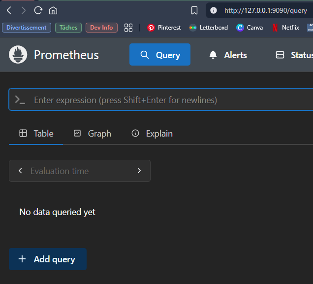
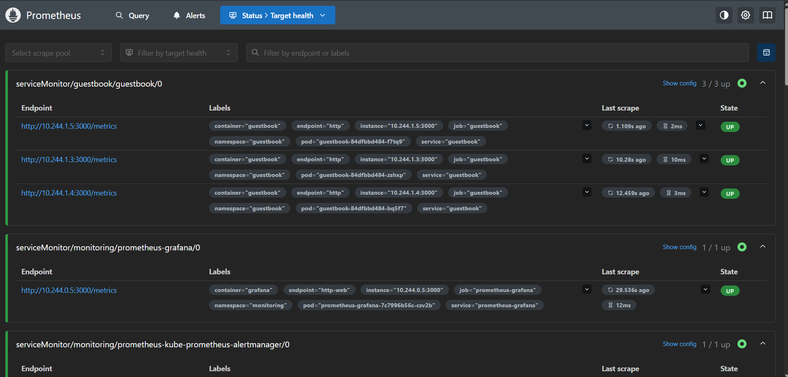

# Apprentissages

## Instrumenter le guestbook

Modifier l'interface de Prometheus pour que son interface web affiche la latende des pods dans ses métriques.

### Problème rencontré et pourquoi il est survenu
J'ai demandé de l'aide pour les modifications de code dans le fichier metrics.go car je n'avais aucune idée de ce que je devais réaliser précisément ni meme le langage en soit.

### Solution appliquée et pourquoi cette solution fonctionne
J'ai demandé de l'aide.

### Ce que j'ai appris
Constuit la nouvelle image et la charger dans Minikube
```
docker build -t guestbook:v1.1.0 guestbook/
```

```
minikube -p observability image load guestbook:v1.1.0
```

Puis je déploy la nouvelle version avec helm
```
helm upgrade guestbook deploy/guestbook -n guestbook
```

Pour vérifier les nouveaux pods
```
kubectl get pods -n guestbook
```

```
kubectl get svc -n guestbook --show-labels
```

Réaliser un servicemonitor.yaml puis lancer le avec kubectl
```
kubectl apply -f exercise-3/servicemonitor.yaml
```

Lancer l'application web avec la commande kubectl port-forward
```
kubectl port-forward -n monitoring svc/prometheus-kube-prometheus-prometheus 9090:9090
```



---

