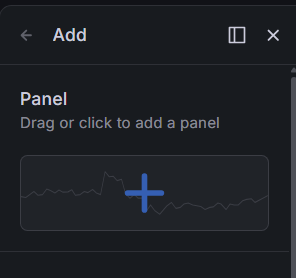
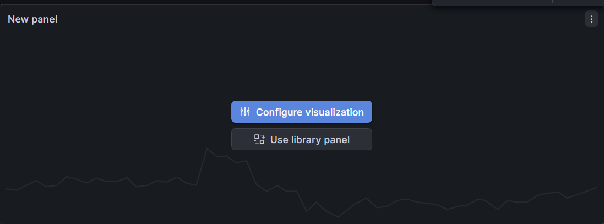
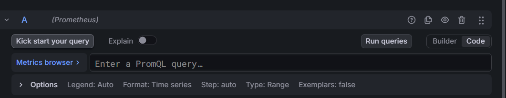
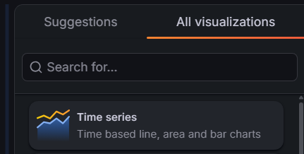
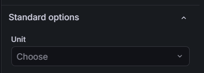
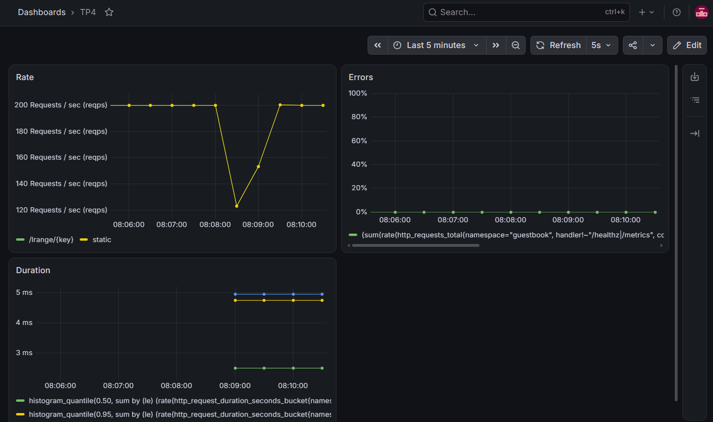

# Apprentissages

## Construire un dashboard RED

Créer un dashboard RED qui récapitule les données les plus importantes en cas d'alerte.

### Problème rencontré et pourquoi il est survenu
Je ne comprends pas l'interface de grafana, sur quelles options il faut intéragir c'est hyper brouillon.

### Ce que j'ai appris
Lancer un tunnel grafana
```
kubectl port-forward -n monitoring svc/prometheus-grafana 8080:80
```

Construire et charger l'image en 1.1.0
```
docker build -t guestbook:v1.1.0 guestbook/
```

```
minikube -p observability image load guestbook:v1.1.0
```

Mettre à jour avec helm
```
helm upgrade guestbook deploy/guestbook -n guestbook
```

Créer la ConfigMap du script et lancer le Job k6
```
kubectl create configmap k6-script -n guestbook --from-file=deploy/k6/load-test.js
```

```
kubectl apply -f deploy/k6/k6-job.yaml
```

Une fois sur l'application web Grafana

On crée un nouveau panel.


On configure la visualisation du panel.


On rentre la requete voulu en PromQL en mode code.


A droite on choisit All visualisation et Time series pour avoir de belles courbes de nos métriques.


On oublie pas de choisir une unité.


On répète l'opération avec les métriques que l'on veut.

Voici le résultat final !
